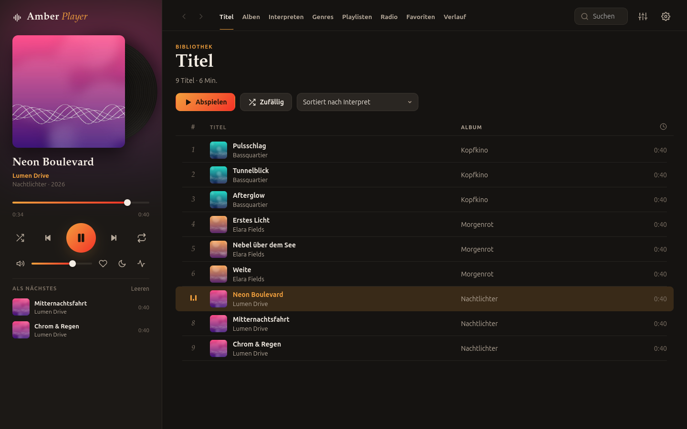

# Bedienung

<table><tr><td align="center" valign="top"> Amber Player am PC: links „Läuft gerade“ und Als Nächstes, rechts die Bibliothek</td></tr></table>
## Die Oberfläche

**Am PC** hat Amber Player zwei Bereiche:

- **Links die Player-Spalte:** Cover, Titel, Fortschritt, Steuerung, Lautstärke, Favorit,
  Sleep-Timer, Visualisierung und darunter **Als Nächstes**.
- **Rechts die Bibliothek** mit den Reitern oben, der Suche und den Symbolen für Effekte und
  Einstellungen.

**Am Handy** (und am Tablet hochkant) gibt es unten eine Leiste mit **Titel, Alben, Playlisten,
Radio, Mehr** und darüber den Mini-Player. Ein Tipp darauf öffnet **Läuft gerade** im Vollbild.

## Menüs

| Wo | Am PC | Am Handy |
|---|---|---|
| Titel | Rechtsklick | lange drücken |
| Gespeicherter Radiosender | Rechtsklick | lange drücken |
| Mehrere Titel | Strg/Umschalt + Klick, dann Rechtsklick | – |

Im Titel-Menü: **Als Nächstes spielen**, **Zur Warteschlange**, **Zu Playlist hinzufügen**,
**Zu Favoriten**, **Zum Album**, **Zum Interpreten**, in Playlisten **Aus Playlist entfernen**.

Am Handy öffnen sich Menüs als Leiste von unten; Untermenüs (z. B. die Playlisten) per Tippen,
mit **Zurück** oben.

## Wiedergabe

| Steuerung | Wirkung |
|---|---|
| ⏮ / ⏭ | voriger / nächster Titel (⏮ nach 3 Sekunden: zurück an den Anfang) |
| 🔀 | Zufallswiedergabe |
| 🔁 | Wiederholen: aus → alle → diesen Titel |
| ♡ | laufenden Titel als Favorit |
| 🌙 | Sleep-Timer: in 15, 30, 45, 60 oder 90 Minuten pausieren |
| **Leeren** (bei Als Nächstes) | alles nach dem laufenden Titel aus der Warteschlange entfernen |

Lange Titel laufen als Laufschrift durch, wenn sie nicht in ihren Platz passen.

### Lückenlos und Überblendung

Titel laufen **lückenlos** ineinander: Amber Player öffnet den nächsten Titel schon ein paar
Sekunden vor dem Ende, so entsteht keine Pause – wichtig bei Live-Alben, DJ-Mixen und
Konzeptalben.

Wer es weicher mag, stellt unter **Einstellungen → Wiedergabe → Überblendung** 2 bis 12 Sekunden
ein: Dann blendet der nächste Titel am Ende ein, während der alte ausblendet. Titel, die auf einem
Album direkt aufeinander folgen (z. B. Track 4 → 5), laufen trotzdem lückenlos ineinander, damit
zusammenhängende Stücke nicht zerrissen werden. Überspringen mit ⏭ wechselt immer sofort.

## Tastenkürzel (PC)

| Taste | Wirkung |
|---|---|
| Leertaste | Abspielen / Pause |
| ← / → | 10 Sekunden zurück / vor |
| Strg + ← / → | voriger / nächster Titel |
| Strg + ↑ / ↓ | lauter / leiser |
| M | Stumm |
| S | Zufall |
| R | Wiederholen |
| Strg + F | Suchen |
| Strg + A | alle Titel markieren |
| Entf | markierte Titel aus der Playlist entfernen |
| V | Visualisierung öffnen/schließen |
| F (in der Visualisierung) | Vollbild |
| 1–9 (in der Visualisierung) | Motiv wählen |
| Esc | Visualisierung schließen |

**Medientasten** der Tastatur, Kopfhörer und Bluetooth-Geräte funktionieren auch – am PC über
die Mediensteuerung des Systems (GNOME, KDE), am Handy über die Benachrichtigung.

## Automatische Playlisten

Oben unter **Playlisten** stehen zwei Listen, die sich von selbst aktualisieren:

- **Alle Titel** – deine ganze Bibliothek.
- **Kürzlich hinzugefügt** – Dateien, die in den letzten 30 Tagen in deine Musikordner kamen
  (nach Dateidatum). Ältere fallen von selbst heraus, neue kommen dazu.

Ein Titel aus der **Suche** spielt sofort; danach geht es mit der bisherigen Warteschlange weiter.

## Einstellungen

| Bereich | Was du dort einstellst |
|---|---|
| **Musikordner** | Ordner hinzufügen, entfernen, neu einlesen; **kurze Dateien ausblenden** (unter 10/30/60 s, z. B. Sprachnachrichten, Klingeltöne) und **Ordner ausschließen** (z. B. „WhatsApp Audio“) – die Dateien selbst bleiben unangetastet |
| **Fehlersuche** | **Protokoll** ein/aus – zeichnet Titelwechsel, Fehler, Medientasten und Kopfhörer-Wechsel auf; ansehen, teilen bzw. exportieren, leeren |
| **Wiedergabe** | **Überblendung** (aus = lückenlos, 2–12 s) und **Lautstärke-Anhebung** (+3 bis +12 dB für leise Kopfhörer; ein Begrenzer verhindert Übersteuern) |
| **Fernsteuerung & MCP** (PC) | API-Adresse, Heimnetz-Freigabe, Token, **Handy koppeln**, Beispiele für Stream Deck |
| **Aufs Handy streamen** (PC) | Playlisten als `.m3u` für andere Player-Apps (z. B. Poweramp) |
| **Cover** | automatische Cover-Suche an/aus, fehlende erneut suchen |
| **Plugins** | Plugin-Ordner öffnen (PC) bzw. Plugins importieren (Handy) |
| **Darstellung** | Sprache, Akzentfarbe, Dunkel/Hell/System, Vollbild (Handy), Tastenkürzel |
