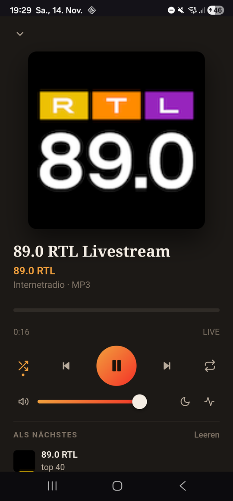
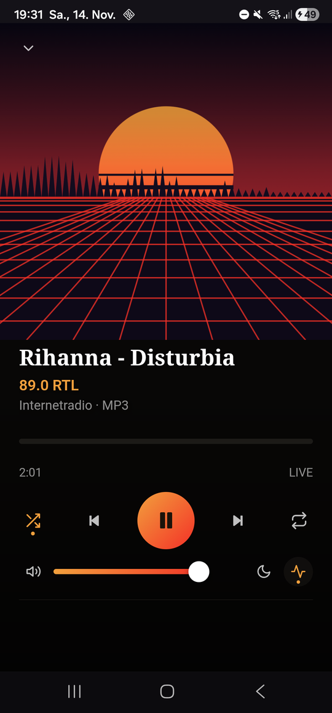
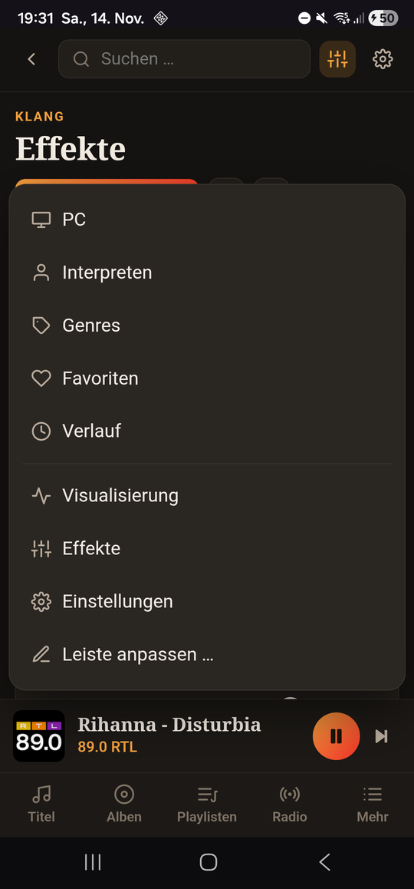

# Handy-App (Android)

Die Android-App ist ein vollwertiger Amber Player: eigene Bibliothek, Playlisten, Effekte,
Visualisierungen und Radio – auch ganz ohne PC. Mit einem gekoppelten PC kommen Fernsteuerung
und Streaming dazu, siehe [Mit dem PC verbinden](Mit-dem-PC-verbinden.md).

<table><tr><td align="center" valign="top"> Läuft gerade</td><td align="center" valign="top"> Mit Visualisierung dahinter</td><td align="center" valign="top"> „Mehr“ mit „Leiste anpassen“</td></tr></table>

Installation: [Installation → Android](Installation.md#android-handy-und-tablet)

## Aufbau

- **Unten:** die Leiste **Titel · Alben · Playlisten · Radio · Mehr**.
- **Darüber:** der Mini-Player mit Cover, Titel, Play/Pause und Weiter.
- **Ein Tipp auf den Mini-Player** öffnet **Läuft gerade**: großes Cover, Fortschritt,
  Steuerung, Lautstärke, Favorit, Sleep-Timer, Visualisierung und Als Nächstes. Mit dem Pfeil
  oben links geht es zurück.
- **Mehr** öffnet alles, was nicht in der Leiste steht, außerdem Visualisierung, Effekte und
  Einstellungen.
- **Leiste anpassen:** Einstellungen → Darstellung → **Leiste unten** – welche vier Bereiche
  unten stehen, z. B. **PC** statt Radio. Auch über **Mehr → Leiste anpassen**.

**Tippen** spielt einen Titel ab, **lange drücken** öffnet das Menü (Als Nächstes,
Warteschlange, Zu Playlist, Favorit …).

## Im Hintergrund hören

Amber Player spielt weiter, wenn du die App verlässt oder den Bildschirm ausschaltest:

- In der **Benachrichtigung** und auf dem **Sperrbildschirm** siehst du Cover und Titel und hast
  Zurück, Play/Pause und Weiter.
- **Kopfhörer- und Bluetooth-Tasten** funktionieren.
- **Anruf oder Navigationsansage:** die Musik pausiert und läuft danach weiter.
- **Kopfhörer abgezogen:** die Musik pausiert.
- **App aus der Übersicht gewischt:** die Musik stoppt.

> **Musik stoppt nach einer Weile im Hintergrund?** Dann beendet die Akkuoptimierung die App.
> Beim ersten Start fragt Amber Player danach; nachträglich: Android-Einstellungen → Apps →
> Amber Player → Akku → **Nicht eingeschränkt**.

## Widgets

Lange auf den Startbildschirm drücken → **Widgets** → **Amber Player**:

| Widget | Inhalt |
|---|---|
| **Kompakt** (4×1) | Cover, Titel und Interpret, Zurück · Play · Weiter |
| **Groß** (4×2) | großes Cover, Titel, Interpret, Album und Tasten |
| **Quadrat** (2×2) | Cover als Hintergrund, Titel und Play-Taste |
| **Radio** (4×2) | laufender Sender mit Logo und Song, Senderwechsel, darunter bis zu fünf gespeicherte Sender zum Antippen |

Cover oder Titel antippen öffnet die App. Läuft Amber Player gerade nicht, öffnen auch die Tasten
die App. Die Widgets zeigen den letzten Stand auch nach dem Schließen.

## Effekte für andere Apps

Deine Klangeffekte aus Amber Player können auch in anderen Musik-Apps wirken – z. B. in YT Music,
Spotify oder Poweramp. Einschalten: **Einstellungen → Effekte für andere Apps → Einschalten**.

| Wirkt in anderen Apps | Wirkt nur in Amber |
|---|---|
| Equalizer, Ton, Bass-Booster, Stimmen klarer und alle Filter aus Plugins (z. B. Altes Radio, Amber Studio Klang) | Echo, Verzerrung, Stereobreite, Kopfhörer-Crossfeed |
| Balance, Lautstärke-Anhebung und Begrenzer (nichts übersteuert) | |
| Hall (mit Androids eigenem Hall nachgebildet, klingt etwas anders) | |
| das Kreisen vom 8D-Rundflug | |

An jedem Effekt steht ein kleines Schild: **Auch in anderen Apps**, **Andere Apps: ähnlich**,
**Andere Apps: teilweise** oder **Nur in Amber**.

- Solange die Effekte an sind, zeigt eine **Benachrichtigung**, für welche App sie gerade wirken.
  Dort **Ausschalten** – wieder an geht nur in der App. Wegwischen lässt sie sich nur, solange
  keine Musik läuft.
- Die Effekte laufen weiter, auch wenn du Amber Player aus der App-Übersicht wischst.
- **Erkannte Musik-Apps** (Standard) funktioniert mit Apps, die einen Equalizer anbieten.
  **Gesamten Ton (global)** wirkt auf alles, geht aber nicht auf jedem Handy.
- **Nur eine Equalizer-App gleichzeitig:** Läuft daneben z. B. der Poweramp Equalizer,
  überschreiben sich beide gegenseitig.
- Für Apps, die sich nicht beim Equalizer melden (z. B. die normale YouTube-App), gibt es die
  **erweiterte Erkennung**. Sie braucht eine einmalige Freigabe per USB- oder WLAN-Debugging;
  der Befehl steht in den Einstellungen.

> **Wie das geht:** Android lässt an fremde Apps nur seine eingebauten Bausteine hängen. Amber
> Player schickt darum einen leisen Testton durch deine eingeschalteten Effekte, misst die
> Klangkurve und überträgt sie auf diese Bausteine – auch für Plugins, die es noch gar nicht gibt.

## Vollbild

Standardmäßig blendet die App Status- und Navigationsleiste aus. Wischen vom Rand zeigt sie
kurz an. Abschalten: **Einstellungen → Darstellung → Vollbild**. Ist das Vollbild aus, rückt die
App so ein, dass nichts unter den Leisten verschwindet.

## Musik auf dem Handy

Eingelesen wird der Ordner **Music** im internen Speicher. Lege deine Musik dort ab (gern in
Unterordnern) oder kopiere sie per Kabel hinein. **Einstellungen → Neu einlesen** liest neue
Dateien sofort ein.

## Plugins am Handy

Eigene Klangeffekte (`.json`) und Visualisierungen (`.js`) installierst du über
**Effekte → Installieren** bzw. **Einstellungen → Plugins → Installieren**: Paket (`.amberplugin`) oder
Datei auswählen, fertig. Klang-Plugins wirken nach dem nächsten Start der App, Visualisierungen sofort.
Mehr dazu: [Plugins installieren](Plugins-installieren.md).

## Was es nur am PC gibt

| Funktion | Warum nicht am Handy |
|---|---|
| HTTP-API, MCP-Server, Stream-Deck-Steuerung | Das Handy ist die Fernbedienung, nicht das Ziel. |
| Quellen-Plugins (Online-Musik) | Sie starten Programme, das erlaubt Android nicht. |
| Handy-Streams (`.m3u` für Poweramp) | Dafür gibt es jetzt die direkte PC-Verbindung. |

## Tablets

Hochkant sieht die App aus wie am Handy, „Läuft gerade“ steht mittig. Quer bekommt das Tablet
die Ansicht wie am PC mit Player-Spalte links.

## Sprache

Die App folgt der Systemsprache. Fest einstellen: **Einstellungen → Darstellung → Sprache**.
Die Benachrichtigung folgt immer der Systemsprache.
