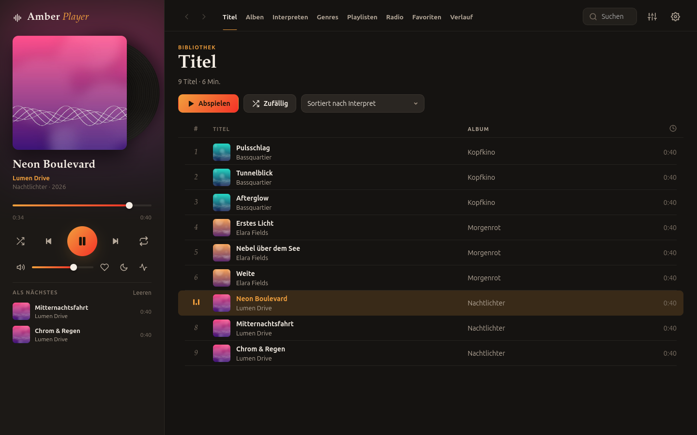
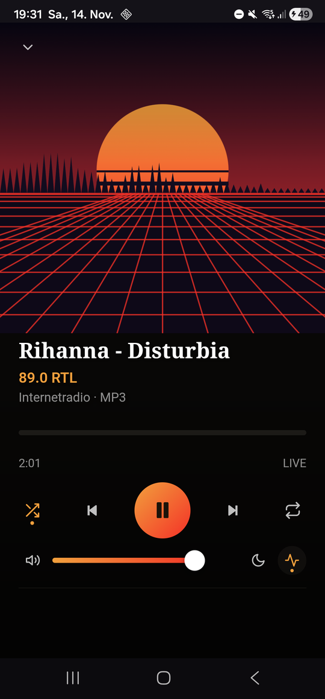
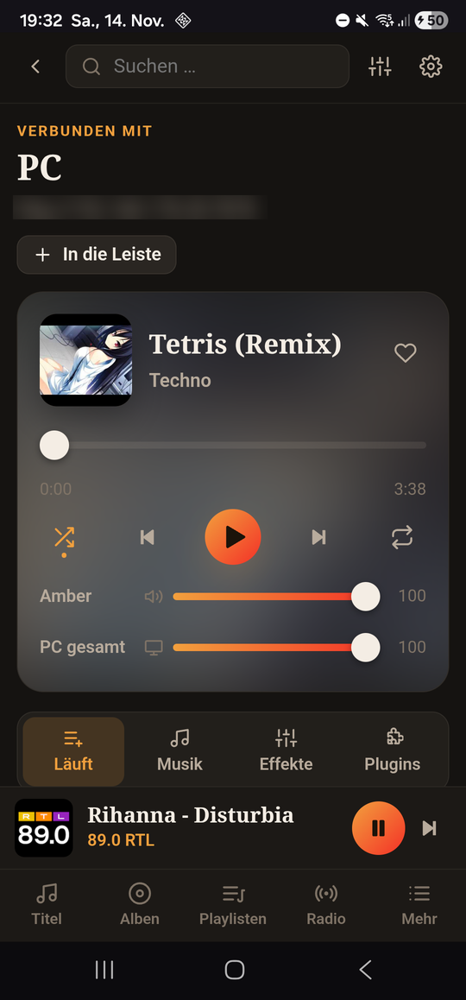
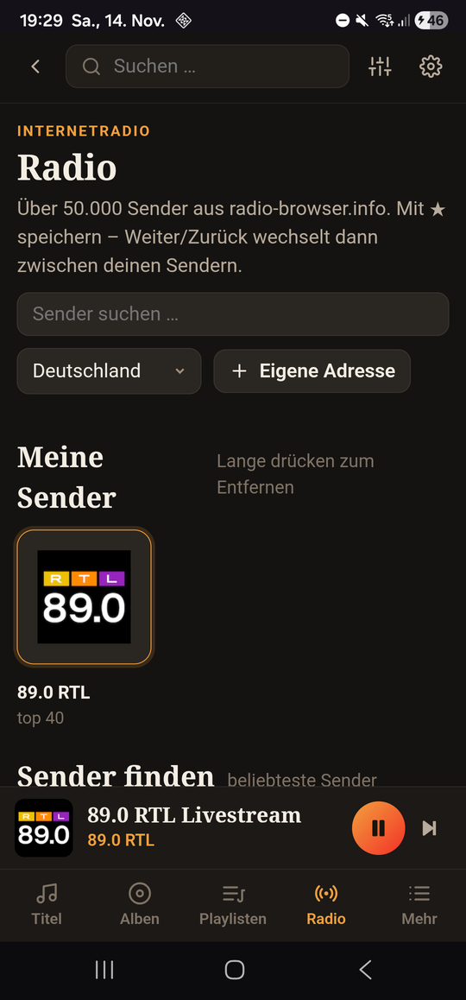
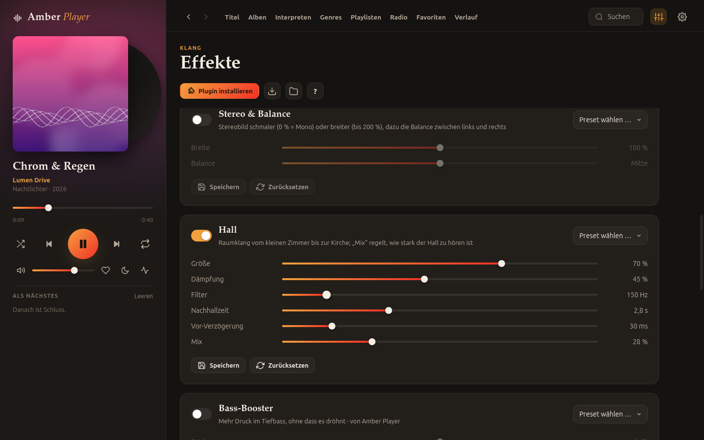
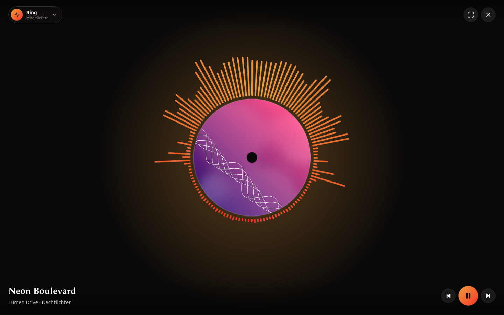
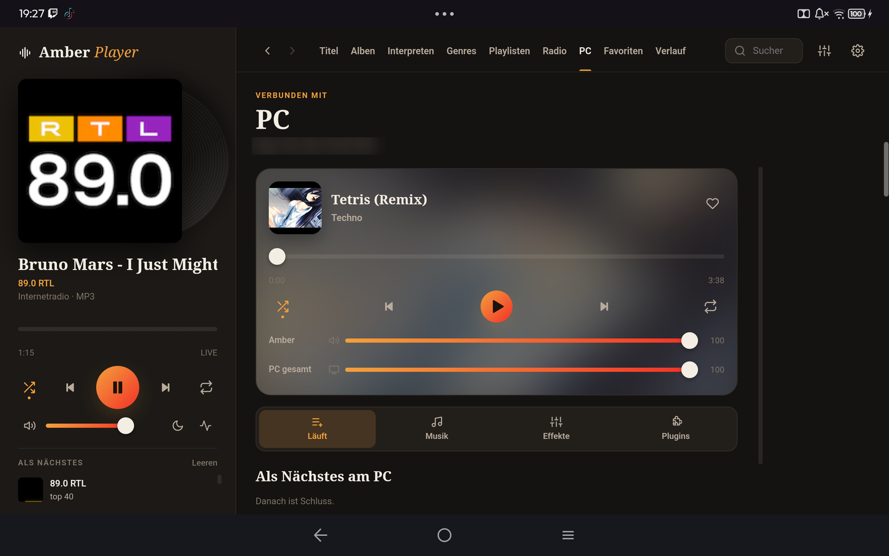
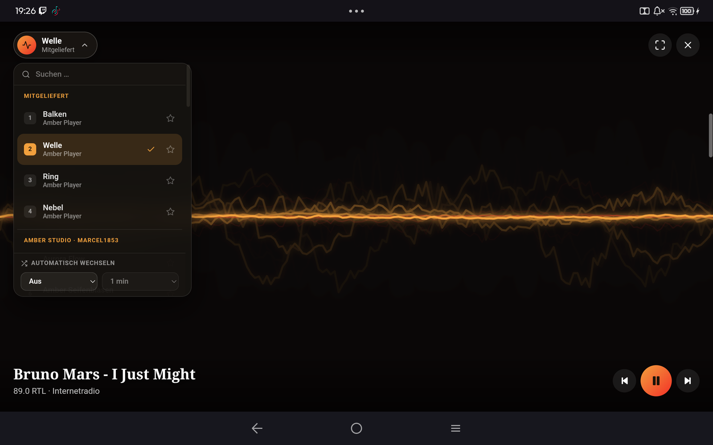

**Deutsch** · [English](en/English.md)

# Willkommen bei Amber Player

Amber Player ist ein kostenloser, werbefreier Musik-Player für **Linux** und **Android**.
Er spielt deine eigene Musiksammlung, Internetradio und Musik, die vom PC aufs Handy gestreamt
wird. Klangeffekte und Visualisierungen sind Plugins – du kannst eigene bauen, ohne den Player
neu zu übersetzen.

<table>
<tr>
<td width="33%"></td>
<td width="33%"></td>
<td width="33%"></td>
</tr>
<tr>
<td align="center">Handy: Visualisierung hinter den Tasten</td>
<td align="center">Handy: PC fernsteuern</td>
<td align="center">Handy: Internetradio</td>
</tr>
</table>

<table>
<tr>
<td width="50%"></td>
<td width="50%"></td>
</tr>
<tr>
<td align="center">Klangeffekte mit Hall</td>
<td align="center">Visualisierung „Ring“ mit Cover</td>
</tr>
<tr>
<td></td>
<td></td>
</tr>
<tr>
<td align="center">Tablet: PC steuern</td>
<td align="center">Tablet: Visualisierung wählen</td>
</tr>
</table>

## Für Einsteiger

1. [Installation](Installation.md) – PC (Linux) und Handy (Android)
2. [Erste Schritte](Erste-Schritte.md) – Musikordner wählen, abspielen, Playlisten
3. [Bedienung](Bedienung.md) – alle Ansichten, Menüs und Tastenkürzel
4. [Häufige Fragen](Häufige-Fragen.md) – wenn etwas nicht klappt

## Funktionen

| Thema | Seite |
|---|---|
| Android-App, Hintergrund-Wiedergabe, Vollbild | [Handy-App](Handy-App.md) |
| Handy mit dem PC koppeln, fernsteuern, streamen | [Mit dem PC verbinden](Mit-dem-PC-verbinden.md) |
| Sender suchen, speichern, eigene Adressen | [Internetradio](Internetradio.md) |
| Equalizer und andere Effekte | [Klangeffekte](Klangeffekte.md) |
| Balken, Welle, Ring, Nebel | [Visualisierungen](Visualisierungen.md) |
| Sprache der Oberfläche | [Sprachen und Übersetzen](Sprachen-und-Übersetzen.md) |

## Erweitern und Steuern

| Thema | Seite |
|---|---|
| Fertige Plugins einspielen | [Plugins installieren](Plugins-installieren.md) · [Plugin-Pakete (.amberplugin)](Plugin-Pakete.md) |
| Eigene Plugins schreiben | [Plugins erstellen](Plugins-erstellen.md) · [Klang-Plugin](Klang-Plugin-erstellen.md) · [Visualisierung](Visualisierung-erstellen.md) · [Quellen-Plugin](Quellen-Plugin-erstellen.md) |
| HTTP-API für eigene Programme | [Fernsteuerung und API](Fernsteuerung-und-API.md) |
| Tasten am Stream Deck oder Tablet | [Stream Deck und TouchDeck](Stream-Deck-und-TouchDeck.md) |
| KI-Assistenten (Claude & Co.) | [MCP und KI-Assistenten](MCP-und-KI.md) |

## Für Entwickler

- [Selbst bauen](Selbst-bauen.md) – PC-Pakete und Android-App aus dem Quellcode
- [Aufbau des Codes](Aufbau-des-Codes.md) – wie die Teile zusammenspielen
- [Sprachen und Übersetzen](Sprachen-und-Übersetzen.md) – eine neue Sprache hinzufügen

## Grundsätze

- **Kostenlos und ohne Werbung.** Immer.
- **Deine Daten bleiben bei dir.** Kein Konto, keine Statistik, kein Tracking.
- **Gleiche Namen sind nicht gleiche Lieder.** Amber Player führt Titel nie nur wegen eines
  gleichen Namens zusammen.
