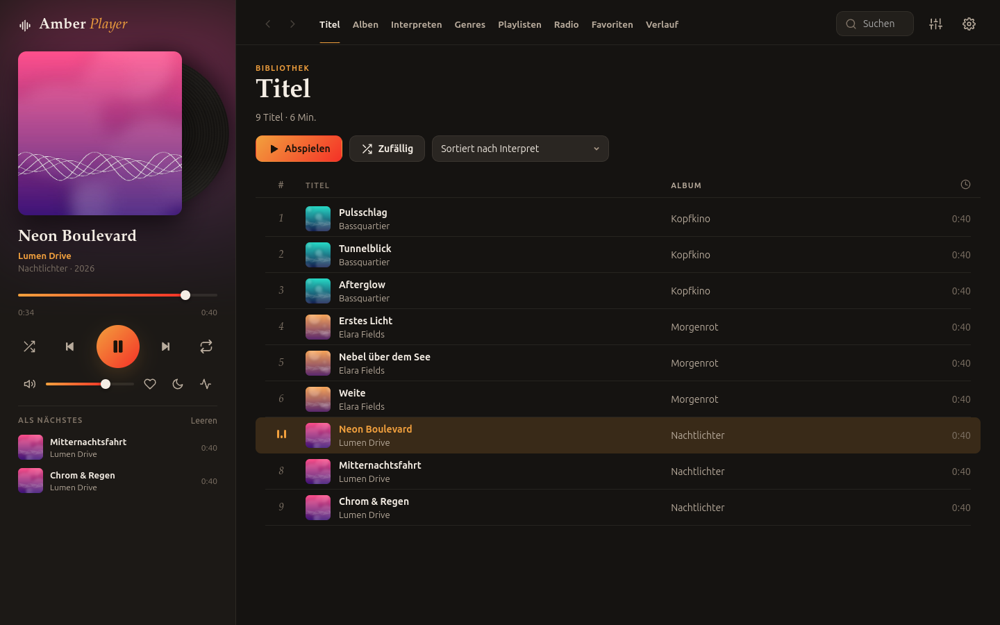
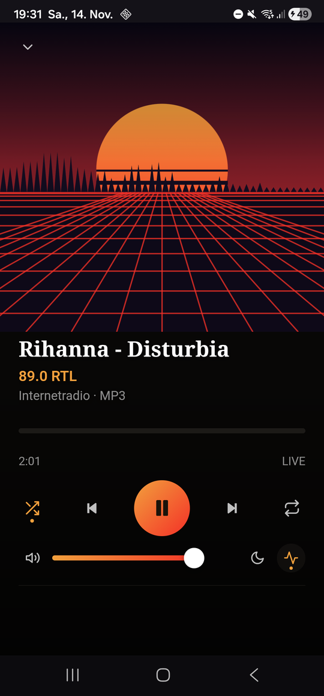
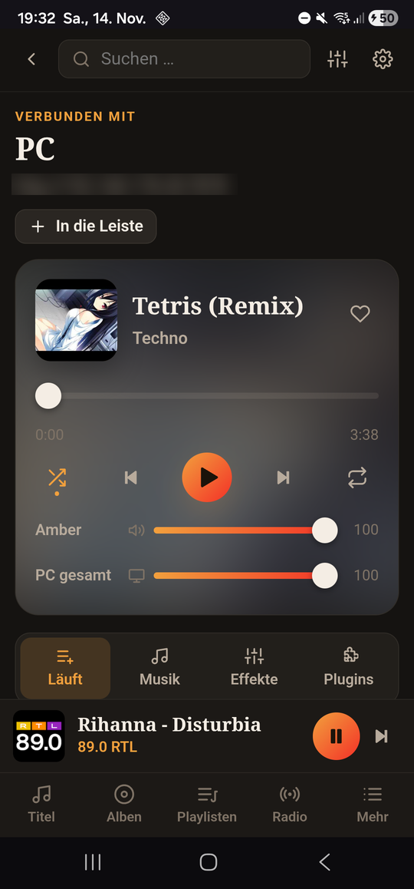
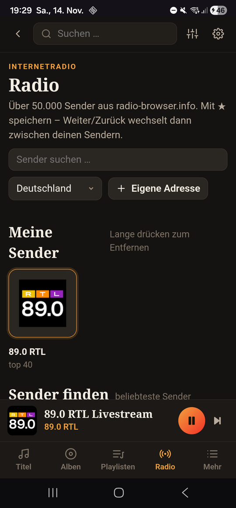
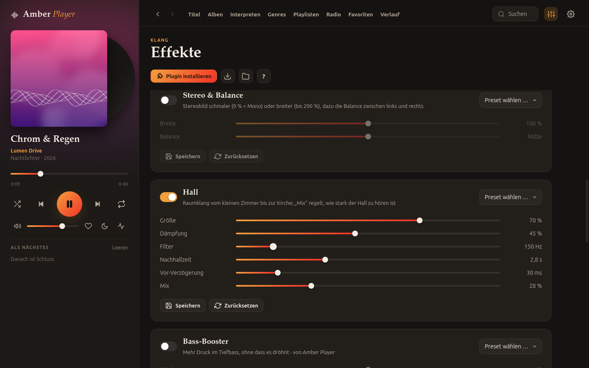
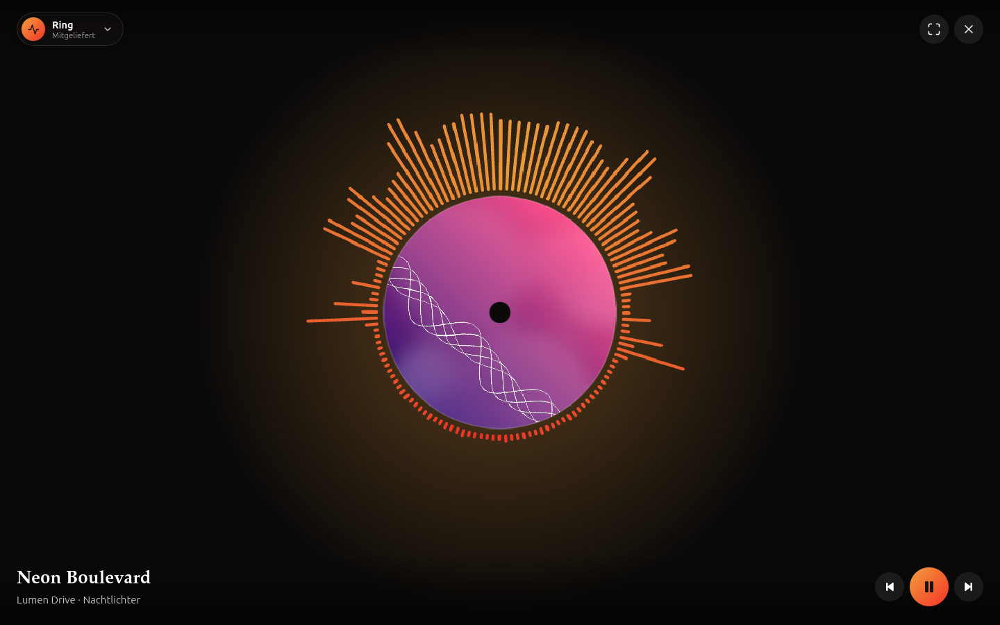
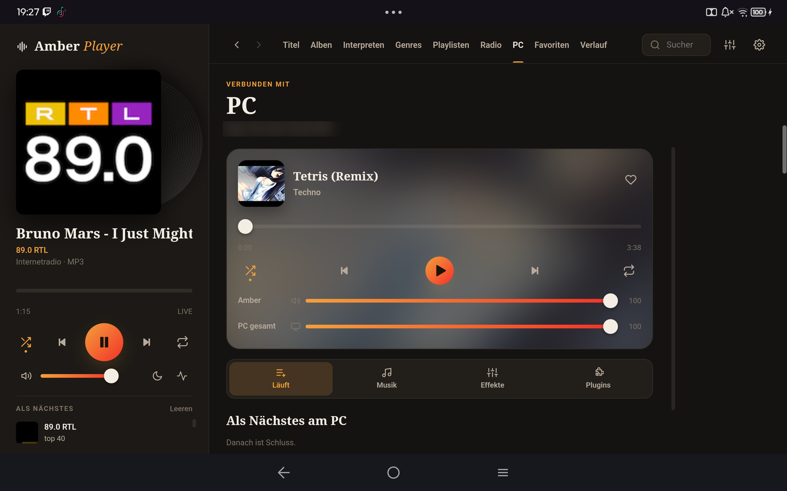
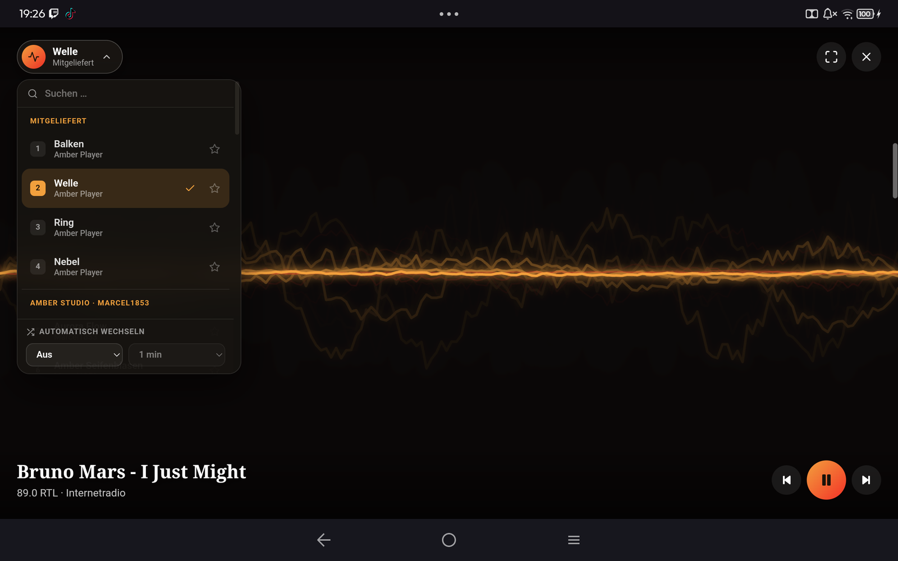

[Deutsch](../Home.md) · **English**

# Welcome to Amber Player

<table>
<tr>
<td width="33%"></td>
<td width="33%"></td>
<td width="33%"></td>
</tr>
<tr>
<td align="center">Phone: visualizer behind the controls</td>
<td align="center">Phone: remote control for the PC</td>
<td align="center">Phone: internet radio</td>
</tr>
</table>

<table>
<tr>
<td width="50%"></td>
<td width="50%"></td>
</tr>
<tr>
<td align="center">Sound effects with reverb</td>
<td align="center">Visualizer “Ring” with cover</td>
</tr>
<tr>
<td></td>
<td></td>
</tr>
<tr>
<td align="center">Tablet: controlling the PC</td>
<td align="center">Tablet: choosing a visualizer</td>
</tr>
</table>

Amber Player is a free, ad-free music player for **Linux** and **Android**. It plays your own
music collection, internet radio and music streamed from your PC to your phone. Sound effects
and visualizers are plugins – you can build your own without recompiling the player.

> Other languages: use your browser's translate function (e.g. right-click → *Translate*).
> The app itself speaks English, German, Spanish, French, Italian, Dutch, Polish and Turkish.

## Getting started

1. [Install](Install.md) – PC (Linux) and phone (Android)
2. [Getting started](Getting-Started.md) – choose a music folder, play, playlists
3. [Usage](Usage.md) – all views, menus and keyboard shortcuts
4. [FAQ](FAQ.md) – when something doesn't work

## Features

| Topic | Page |
|---|---|
| Android app, background playback, full screen | [Phone app](Phone-App.md) |
| Pair your phone with your PC, remote control, streaming | [Connecting to your PC](Connecting-to-your-PC.md) |
| Find and save stations, custom addresses | [Internet radio](Internet-Radio.md) |
| Equalizer and other effects | [Sound effects](Sound-Effects.md) |
| Bars, Wave, Ring, Fog | [Visualizers](Visualizers.md) |
| Interface language | [Languages and translation](Languages-and-Translation.md) |

## Extend and control

| Topic | Page |
|---|---|
| Install ready-made plugins | [Installing plugins](Installing-Plugins.md) · [Plugin packages (.amberplugin)](Plugin-Packages.md) |
| Write your own plugins | [Creating plugins](Creating-Plugins.md) · [Sound plugin](Creating-a-Sound-Plugin.md) · [Visualizer](Creating-a-Visualizer.md) · [Source plugin](Creating-a-Source-Plugin.md) |
| HTTP API for your own programs | [Remote control and API](Remote-Control-and-API.md) |
| Buttons on a Stream Deck or tablet | [Stream Deck and TouchDeck](Stream-Deck-and-TouchDeck.md) |
| AI assistants (Claude & co.) | [MCP and AI assistants](MCP-and-AI.md) |

## For developers

- [Building from source](Building-from-Source.md) – PC packages and Android app
- [Code structure](Code-Structure.md) – how the parts fit together
- [Languages and translation](Languages-and-Translation.md) – add a new language

## Principles

- **Free and without ads.** Always.
- **Your data stays with you.** No account, no statistics, no tracking.
- **Same name doesn't mean same song.** Amber Player never merges tracks just because their
  names match.

## License

Amber Player is free to use but **not open source** – all rights reserved. Writing your own
plugins is explicitly welcome. See [LICENSE](https://github.com/Marcel1853/amber-player/blob/main/LICENSE).
