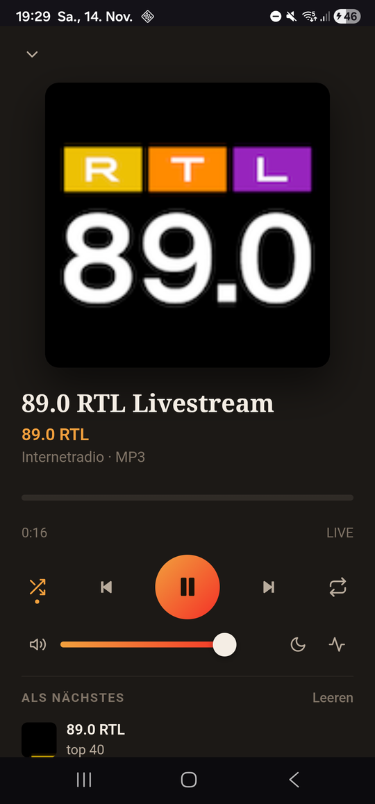
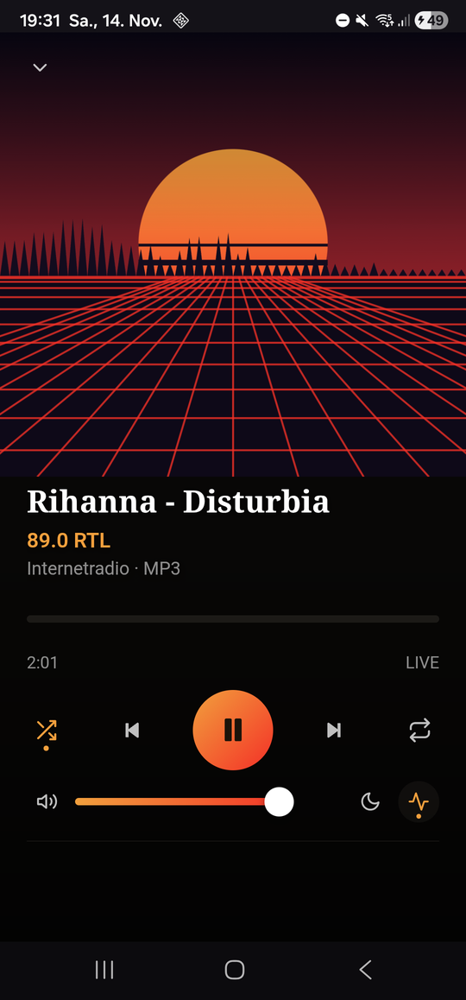
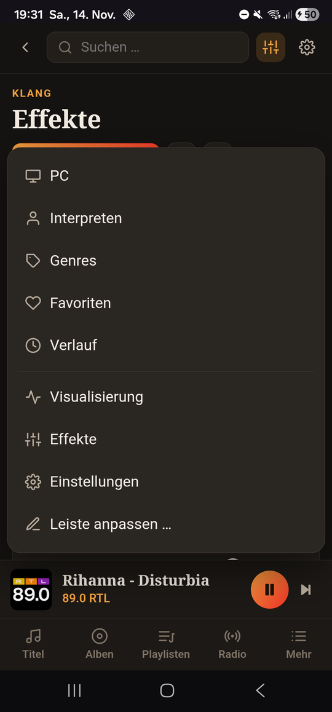

# Phone app (Android)

The Android app is a complete Amber Player: its own library, playlists, effects, visualizers
and radio – even without a PC. With a paired PC you also get remote control and streaming, see
[Connecting to your PC](Connecting-to-your-PC.md).

<table><tr><td align="center" valign="top"> Now playing</td><td align="center" valign="top"> With the visualizer behind it</td><td align="center" valign="top"> “More” with “Customize bar”</td></tr></table>

Installation: [Install → Android](Install.md#android-phone-and-tablet)

## Layout

- **Bottom:** the bar **Tracks · Albums · Playlists · Radio · More**.
- **Above it:** the mini player with cover, title, play/pause and next.
- **Tapping the mini player** opens **Now playing**: large cover, progress, controls, volume,
  favourite, sleep timer, visualizer and Up next. The arrow at the top left takes you back.
- **More** opens everything that isn't in the bar, plus Visualizer, Effects and Settings.
- **Customize the bar:** Settings → Appearance → **Bottom bar** – which four sections are shown
  at the bottom, e.g. **PC** instead of Radio. Also via **More → Customize bar**.

**Tap** plays a track, **long-press** opens its menu (Play next, Add to queue, Add to playlist,
Favourite …).

## Listening in the background

Amber Player keeps playing when you leave the app or turn off the screen:

- The **notification** and the **lock screen** show cover and title with previous, play/pause
  and next.
- **Headphone and Bluetooth buttons** work.
- **Phone call or navigation announcement:** the music pauses and resumes afterwards.
- **Headphones unplugged:** the music pauses.
- **App swiped away from recent apps:** the music stops.

> **Music stops after a while in the background?** Battery optimisation is killing the app.
> Amber Player asks about this on first start; later: Android settings → Apps → Amber Player →
> Battery → **Unrestricted**.

## Widgets

Long-press the home screen → **Widgets** → **Amber Player**:

| Widget | Content |
|---|---|
| **Compact** (4×1) | cover, title and artist, previous · play · next |
| **Large** (4×2) | large cover, title, artist, album and buttons |
| **Square** (2×2) | cover as background, title and play button |
| **Radio** (4×2) | current station with logo and song, station switching, plus up to five saved stations to tap |

Tapping the cover or title opens the app. If Amber Player isn't running, the buttons open the app
too. The widgets keep showing the last state after the app is closed.

## Full screen

By default the app hides the status and navigation bars. Swiping from the edge shows them
briefly. To turn this off: **Settings → Appearance → Full screen**. With full screen off, the app
leaves room so nothing disappears behind the bars.

## Music on the phone

The **Music** folder in internal storage is scanned. Put your music there (subfolders are fine)
or copy it via cable. **Settings → Rescan** picks up new files immediately.

## Plugins on the phone

Install your own sound effects (`.json`) and visualizers (`.js`) via **Effects → Install** or
**Settings → Plugins → Install**: choose the package (`.amberplugin`) or file, done. Sound plugins take effect after the next
app start, visualizers immediately. More: [Installing plugins](Installing-Plugins.md).

## PC-only features

| Feature | Why not on the phone |
|---|---|
| HTTP API, MCP server, Stream Deck control | The phone is the remote, not the target. |
| Source plugins (online music) | They run programs, which Android doesn't allow. |
| Phone streams (`.m3u` for Poweramp) | Replaced by the direct PC connection. |

## Tablets

In portrait the app looks like on the phone, with “Now playing” centred. In landscape the
tablet gets the PC layout with the player column on the left.

## Language

The app follows the system language. To set it: **Settings → Appearance → Language**. The
notification always follows the system language.
