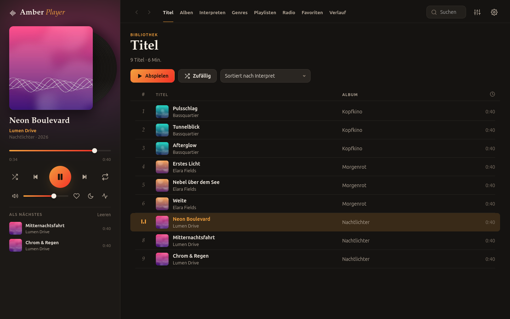

# Usage

<table><tr><td align="center" valign="top"> Amber Player on the PC: “Now playing” and Up next on the left, the library on the right</td></tr></table>
## The interface

**On the PC** Amber Player has two areas:

- **Left, the player column:** cover, title, progress, controls, volume, favourite, sleep timer,
  visualizer and **Up next** below.
- **Right, the library** with tabs at the top, search and the icons for effects and settings.

**On the phone** (and tablets in portrait) there's a bar at the bottom with **Tracks, Albums,
Playlists, Radio, More** and the mini player above it. Tapping it opens **Now playing** in full
screen.

## Menus

| Where | On the PC | On the phone |
|---|---|---|
| Track | right-click | long-press |
| Saved radio station | right-click | long-press |
| Several tracks | Ctrl/Shift + click, then right-click | – |

The track menu offers **Play next**, **Add to queue**, **Add to playlist**, **Add to
favourites**, **Go to album**, **Go to artist**, and in playlists **Remove from playlist**.

On the phone, menus open as a sheet from the bottom; submenus (e.g. the playlists) open with a
tap, with **Back** at the top.

## Playback

| Control | Effect |
|---|---|
| ⏮ / ⏭ | previous / next track (⏮ after 3 seconds: back to the start) |
| 🔀 | shuffle |
| 🔁 | repeat: off → all → this track |
| ♡ | favourite the current track |
| 🌙 | sleep timer: pause in 15, 30, 45, 60 or 90 minutes |
| **Clear** (at Up next) | remove everything after the current track from the queue |

Long titles scroll when they don't fit.

### Gapless and crossfade

Tracks play **gaplessly**: Amber Player opens the next track a few seconds before the end, so
there's no pause – important for live albums, DJ mixes and concept albums.

If you prefer it smoother, set 2 to 12 seconds under **Settings → Playback → Crossfade**: the next
track then fades in at the end while the old one fades out. Tracks that follow each other
directly on an album (e.g. track 4 → 5) still play gaplessly so connected pieces aren't torn
apart. Skipping with ⏭ always switches immediately.

## Keyboard shortcuts (PC)

| Key | Effect |
|---|---|
| Space | play / pause |
| ← / → | 10 seconds back / forward |
| Ctrl + ← / → | previous / next track |
| Ctrl + ↑ / ↓ | louder / quieter |
| M | mute |
| S | shuffle |
| R | repeat |
| Ctrl + F | search |
| Ctrl + A | select all tracks |
| Del | remove selected tracks from the playlist |
| V | open/close visualizer |
| F (in the visualizer) | full screen |
| 1–9 (in the visualizer) | choose a visualizer |
| Esc | close the visualizer |

**Media keys** on keyboards, headphones and Bluetooth devices work too – on the PC through the
system's media controls (GNOME, KDE), on the phone through the notification.

## Automatic playlists

At the top of **Playlists** there are two lists that update themselves:

- **All tracks** – your whole library.
- **Recently added** – files that arrived in your music folders in the last 30 days (by file
  date). Older ones drop out on their own, new ones are added.

A track from the **search** plays immediately; afterwards your previous queue continues.

## Settings

| Section | What you set there |
|---|---|
| **Music folders** | add, remove, rescan folders; **hide short files** (under 10/30/60 s, e.g. voice messages, ringtones) and **exclude folders** (e.g. “WhatsApp Audio”) – the files themselves stay untouched |
| **Troubleshooting** | **Log** on/off – records track changes, errors, media buttons and headphone changes; view, share or export, clear |
| **Playback** | **Crossfade** (off = gapless, 2–12 s) and **volume boost** (+3 to +12 dB for quiet headphones; a limiter prevents clipping) |
| **Remote control & MCP** (PC) | API address, home network access, token, **Pair phone**, Stream Deck examples |
| **Stream to your phone** (PC) | playlists as `.m3u` for other player apps (e.g. Poweramp) |
| **Covers** | automatic cover search on/off, search missing covers again |
| **Plugins** | open plugin folders (PC) or import plugins (phone) |
| **Appearance** | language, accent colour, dark/light/system, full screen (phone), keyboard shortcuts |
